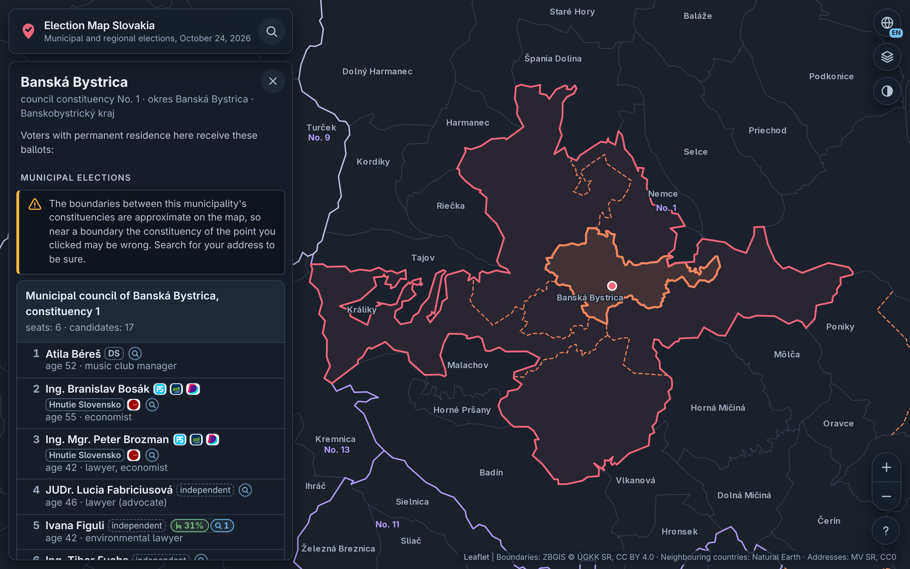

# Election Map Slovakia

A zoomable map of every constituency of the Slovak municipal and regional
elections of 24 October 2026, with the candidates standing in each and
their results. Click a place or search for an address, a municipality or
a candidate to see every ballot voted on there; a candidate card adds
AI-researched, source-linked notes on the candidate's career and
controversies. Circle candidates' numbers as on the ballot to gather them
in one list, which a link shares. The results, shown live as they were
counted on election night, are each candidate's votes, the turnout and
the winners, on the ballots and on the map, down to the polling districts
([docs/results.md](docs/results.md)).
It is at **<https://volebnamapa.sk>**.



It is a static site: a Python pipeline turns official open data into plain
files, served as they are by Cloudflare Pages. The browser loads nothing
from other servers than the site's own, the results included.

## Install

You need [git](https://git-scm.com/) and
[uv](https://docs.astral.sh/uv/getting-started/installation/); uv brings
the Python (3.11 or newer) and the packages.

```sh
git clone https://github.com/pbasista/election-map-slovakia.git
cd election-map-slovakia
uv sync
```

## Run

```sh
uv run ems fetch     # download the official inputs into data/raw/ (about 230 MB)
uv run ems make      # build the site into dist/ and check it
uv run ems serve     # serve it at http://127.0.0.1:8000/
```

Then open <http://127.0.0.1:8000/> in a browser. After changing `config/`,
`data/curated/` or `web/`, run `uv run ems make` again; it redoes only the
steps whose inputs changed.

## Documentation

- [docs/pipeline.md](docs/pipeline.md) — every `ems` command, what each step
  makes, and the configuration files
- [docs/frontend.md](docs/frontend.md) — how the page works
- [docs/agent-jobs.md](docs/agent-jobs.md) — translations, constituency
  rules and candidate research by AI agents
- [docs/deploy.md](docs/deploy.md) — CI, releases, Cloudflare Pages and the
  site's own domain
- [docs/results.md](docs/results.md) — the election results: their files,
  sources and an election night
- [docs/testing.md](docs/testing.md) — the checks, and the site in a
  headless browser with its results or dummy ones
- [CHANGELOG.md](CHANGELOG.md)

## Development

```sh
uv run ruff format --check .
uv run ruff check .
uv run ty check
uv run pytest
npx --yes @biomejs/biome@2.5.12 ci
```

A push to any branch runs these checks; a version tag builds the site and
deploys it ([docs/deploy.md](docs/deploy.md)). To see a change in a
browser, see [docs/testing.md](docs/testing.md).

The screenshot above, `docs/img/main.png`, is taken from the built site by
`python3 scripts/screenshot.py` (after `uv run ems build`), the page as on
the day before the elections, without the voting line and the results. It
needs only a Chromium-family browser, found on `PATH` or passed with
`--browser`.

## License

EUPL-1.2, see [LICENSE](LICENSE). The data sources and their licenses are
listed in [NOTICE](NOTICE).
